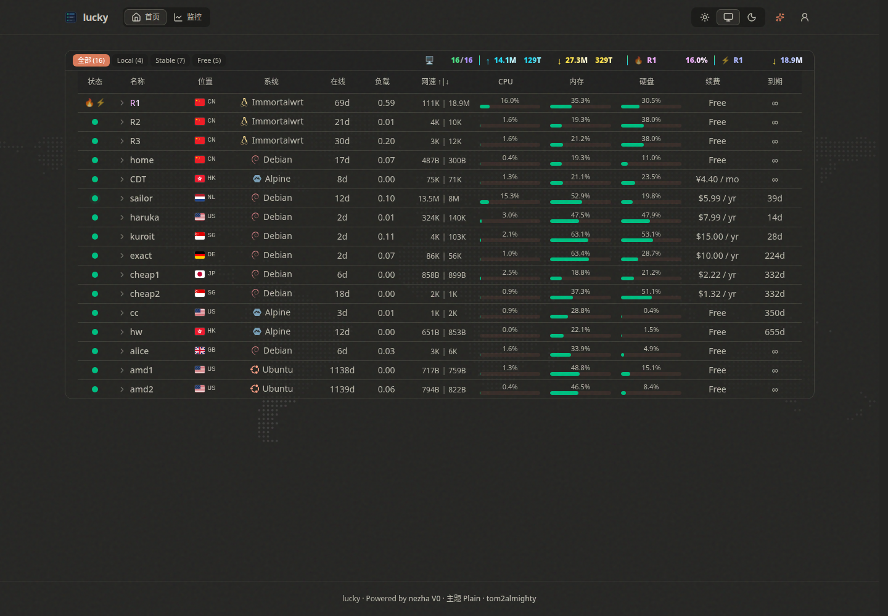
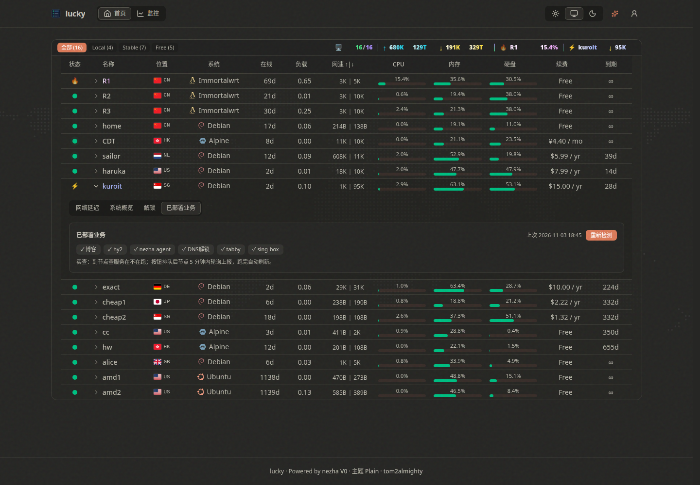
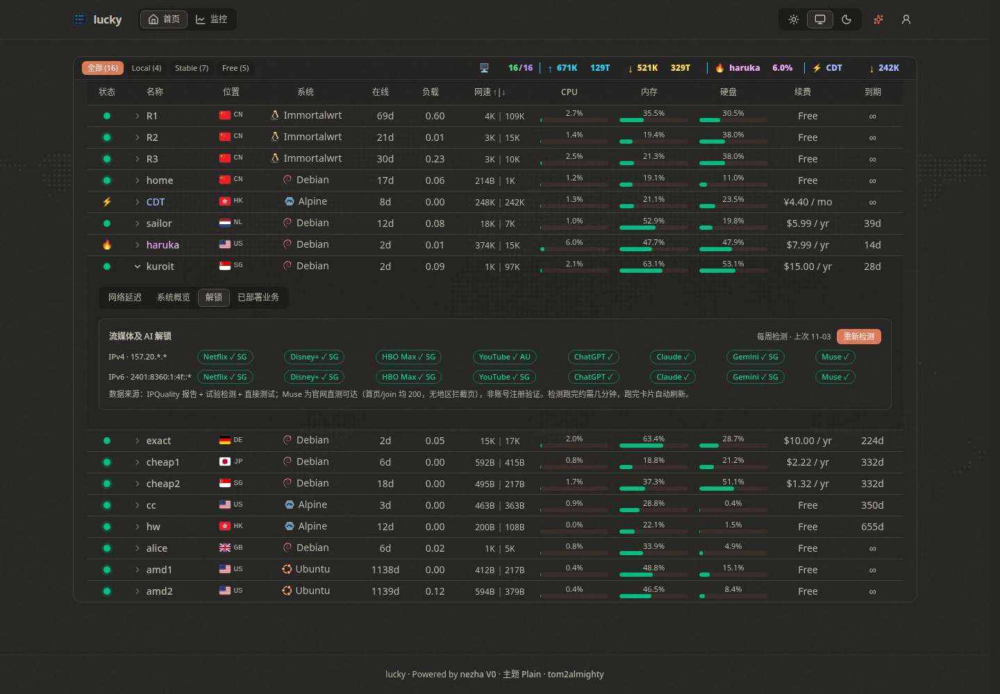

# Plain

基于 [tom2almighty/monitor-theme-design](https://github.com/tom2almighty/monitor-theme-design) 定制的 nezha-zero 公开页前端：整页扁平化，节点一览 + 解锁与已部署业务实查。

## 截图

首页：顶部统计栏 + 节点表（深色模式）



节点详情 → 已部署业务：实查徽标 + 上次时间 + 重新检测



节点详情 → 解锁：8 项服务分 IPv4 / IPv6 两行，IP 由前端脱敏



## 功能

- **整页扁平化**：去掉全部装饰阴影、渐变、毛玻璃与顶部高光，改实色；选中分组 pill 保持蓝色实色 `#0A6CFF`。保留壁纸、彩虹 logo、统计栏多彩字、焦点圈、圆点纹理与 🔥⚡ 脉动、圆角。
- **点阵世界地图**：列表下方与 Prism 同款的 canvas 点阵地图（Natural Earth 陆地掩码 330×133），亮色圆点 + 暗色晕影，海岸线微光扫过；节点按国家/城市坐标标在地图上，在线绿圈、离线红圈，最忙 🔥、最快 ⚡ 脉动。
- **顶部统计栏**：在线数、实时 + 累计流量、最忙（🔥）、最快（⚡），按当前分组统计。
- **节点列表**：状态列徽标逻辑（最忙 🔥、最快 ⚡）与行名同步变色；末列为到期；展开行同时只开一个节点。
- **详情 4 个标签页**：网络延迟、系统概览、解锁、已部署业务。
  - 网络延迟：延迟图档位 1 小时 / 6 小时 / 24 小时。
  - 解锁：Netflix、Disney+、HBO Max、YouTube、ChatGPT、Claude、Gemini、Muse，IPv4 一行、IPv6 一行；IP 前端脱敏（v4 只显前两段，v6 只显前缀）。
  - 已部署业务：到节点实查服务在不在跑，徽标 ✓ 在跑 / ✗ 停了 / ? 未知，附上次检测时间；点「重新检测」排队重查，查完自动刷新。
- **流量校准**：配套的服务端（见下方 `CAL`）存取每月流量校准，校准密码只存 PBKDF2 哈希。
- **亮色 / 暗色**，移动端单元格紧凑（上下内边距 6px）。

## 部署方式

### 准备工作

- 一台在跑的 nezha-zero 面板（dashboard）。本项目只是公开页前端，**不含面板本身**，按 nezha-zero v0.20.x 开发验证；v1 的接口与页面结构不同，不适用。
- 一台能跑 Docker 的主机；本地构建需要 Node.js（建议 20+）。

### 步骤

```bash
git clone https://github.com/ypkin/plain-nezha.git
cd plain-nezha

# 1. 本地构建（产物 dist/，不进 git）
npm install
npm run build

# 2. 改 deploy/docker-compose.yml 里的环境变量（见下表）
# 3. 把 deploy/default.conf.template 里的 <your-panel-domain> 换成你自己的面板主域名
#    （配套小服务没有的，把模板里对应 location 删掉）

# 4. 构建并启动
docker compose -f deploy/docker-compose.yml up -d --build
```

容器监听 `127.0.0.1:8086`，自己再反代域名并上证书，例如：

```nginx
server {
    listen 443 ssl;
    server_name <your-frontend-domain>;

    location / {
        proxy_pass http://127.0.0.1:8086;
        proxy_http_version 1.1;
        # /ws 是 WebSocket，这两行必须透传，否则无法升级成 ws 连接
        proxy_set_header Upgrade $http_upgrade;
        proxy_set_header Connection "upgrade";
        proxy_set_header Host $http_host;
    }
}
```

### 对接 nezha-zero 面板

架构只有一句话：**前端是纯静态 SPA，浏览器永远不直连面板**。所有面板数据都走容器内 nginx 同源透传，这样既没有跨域问题，面板地址也不会暴露给访客。面板地址只存在于容器启动时的环境变量里，构建产物里没有写死面板地址——以后换面板只改环境变量重启容器，不用重新 `npm run build`。

#### 面板侧要满足的条件

- 面板对访客开放公开页。前端首屏是不带登录凭据抓面板首页的，面板关了公开访问会 401，前端直接显示已关闭。
- 面板要能从前端容器访问到。`NEZHA` 填内网地址就行（同一台机就 `http://127.0.0.1:8008/`，跨机就填内网 IP），不需要把面板端口暴露到公网。
- 每个节点的计费信息（价格、到期、流量套餐、国家代码）来自面板里该节点的 PublicNote 字段。不填的节点价格与到期显示为 Free/∞，国家回退到 agent 上报的 CountryCode。
- 详情页「网络延迟」曲线来自面板的监控任务（service monitor），面板里没配监控任务就没有延迟曲线（资源图不受影响，资源图是前端自己从实时流里攒的）。
- 登录只在面板域名上发生。本前端自身没有登录态，顶栏的登录/后台入口只是跳到面板域名；面板的 GitHub OAuth 回调登记的也必须是面板域名（见下）。

#### 前端调面板的 6 条通道（都在 `deploy/default.conf.template` 里）

| 前端请求 | 透传到面板 | 干什么 | 不通的表现 |
| --- | --- | --- | --- |
| `GET /panel-snapshot` | 面板首页 HTML | 首屏数据：节点列表、PublicNote 计费备注、站点名。前端从首页 HTML 里提取内嵌的 `JSON.parse('...')` 数据包；实时流里没有 PublicNote，所以这条不能少 | 首页空白、无节点 |
| `WSS /ws` | 面板 `/ws` | 实时推送：每 2 秒一次的 `{now, servers}`，在线状态、流量、负载全靠它；30 秒收不到就切 5 秒轮询快照兜底，5 秒后重连 | 列表有但数字永远不动、全节点显示离线 |
| `GET /api/v1/monitor/{id}` | 面板 `/api/` | 延迟历史：面板监控任务的 24 小时分钟级桶（null、0 或 ≥1000ms 的桶算丢包） | 详情页没有延迟曲线 |
| `/static/` | 面板 `/static/` | 面板静态资源（快照页引用的脚本/样式走这里） | 快照解析异常 |
| `/oauth2` | 面板域名 | 登录回调透传（GitHub OAuth 等） | 登录后回不到面板 |
| `/login`、`/admin`、`/dashboard` | **不透传，302 跳面板主域名** | 面板的 GitHub OAuth 回调只认一个域名，登录 cookie 也种在发起登录的域名上；在前端域名下透传 `/login` 会导致回调落点与 cookie 对不上，面板报「登录过程中发生错误」，所以这三处必须整页跳过去 | 登录报错 |

#### `/ws` 的 Host 必须带端口（最容易踩的坑）

nezha-zero 的 `/ws` 握手做 Origin 检查：浏览器 Origin 的 host 必须等于转发后的请求 Host。nginx 的 `$host` 会剥掉端口——浏览器连的是 `wss://域名:8443/ws`，转发的 Host 却变成 `域名`，对不上就 403，表现就是全节点离线（快照接口是普通 HTTP 不受影响，所以列表数据正常、只有实时状态全灭）。模板里 `/ws` 段和外层反代一律用 `proxy_set_header Host $http_host`（保留端口）。走标准 443/80 时 `$host` 与 `$http_host` 相同，不会触发；用 IP:端口或非标准端口访问时一定触发。

#### 联调检查清单（按顺序查，前面通了再查后面）

1. 首页能列出节点 → `/panel-snapshot` 通。
2. 等几秒看网速数字会不会变 → `/ws` 通；数字不动先看浏览器控制台的 ws 是不是 403，再查上面那条 Host 端口。
3. 点节点详情 → 网络延迟有曲线 → `/api/v1/monitor` 通且面板配了监控任务；只有资源图没有延迟曲线就是面板没配监控任务。
4. 点顶栏用户图标或访问 `/admin` → 跳到面板域名登录页 → 登录跳转通。

### 环境变量

模板变量在容器启动时由 nginx:alpine 的 envsubst 替换，不需要自己渲染模板。

| 变量 | 说明 |
| --- | --- |
| `DOMAIN` | 容器内 nginx 的 server_name，Dockerfile 默认 `_`（全接）。容器自身不终结 TLS、前面还有一层反代时不用改 |
| `NEZHA` | 面板地址，**必须以 `/` 结尾**，如 `http://127.0.0.1:8008/`。模板是直接拼接的（`${NEZHA}ws`、`${NEZHA}static/`），少了尾斜杠会拼成 `8008ws` 这种非法地址 |
| `NEZHA_ORIGIN` | 面板主域名（不带尾斜杠），`/oauth2` 透传到这里 |
| `CAL` | 流量校准服务地址，可选；没有就留空**并删模板里 `/cal/` 段**，只留空不删段启动会报错 |
| `UNLOCK` | 解锁聚合服务地址，可选；没有就留空并删模板里 `/unlock/` 段 |
| `SERVICES` | 已部署业务汇总服务地址，可选；没有就留空并删模板里 `/services/` 段 |

### 路由说明

容器内 nginx（`deploy/default.conf.template`，环境变量替换）：

- `/` 与 `/assets/`：前端静态文件。
- `/panel-snapshot`、`/ws`、`/api/`、`/static/`：透传给面板。
- `/login`、`/admin`、`/dashboard`：302 跳到面板主域名。OAuth 回调只登记主域名，透传跨域对不上，所以这里必须跳。
- `/unlock/`、`/cal/`、`/services/`：分别透传给配套小服务。

配套小服务（流量校准、解锁聚合、业务汇总）不在本仓库内，需要另外部署；没有就不配，前端对应标签页/按钮不出现。

## 本地开发

```bash
npm install
npm run dev      # 开发服务器
npm run build    # tsc -b && vite build，产物在 dist/
npm run preview  # 本地预览构建产物
```

## 协议与致谢

- 本项目基于 [MIT License](LICENSE) 开源。
- 原作者 [tom2almighty](https://github.com/tom2almighty) 的 [monitor-theme-design](https://github.com/tom2almighty/monitor-theme-design)，页脚署名保留。
- 感谢 [monitor-probe/monitor](https://github.com/monitor-probe/monitor)。
- 国旗图标来自 [flag-icons](https://github.com/lipis/flag-icons)，MIT 协议。
